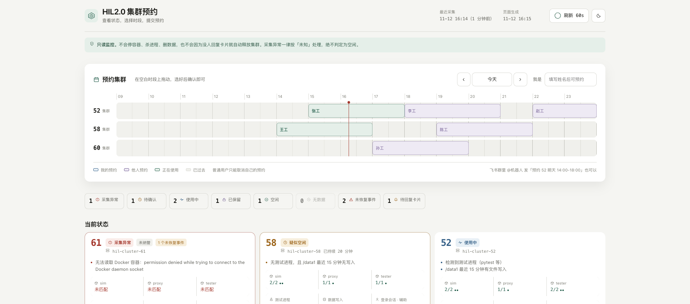
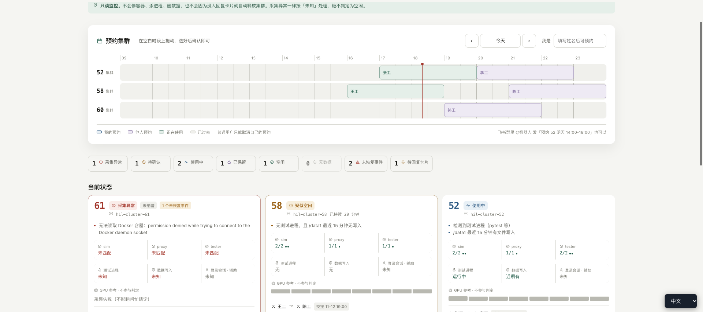
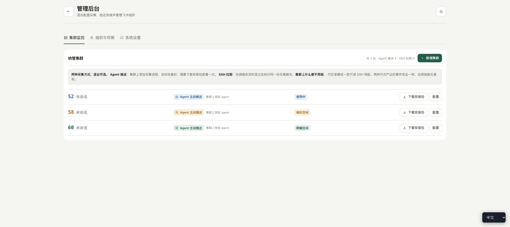

# HIL2.0 GPU Cluster Handoff

**Language:** [简体中文](README.md) · English · [日本語](README.ja.md)

**The hard question in a shared GPU lab is “can this machine be handed to the next person?”** GPU utilization and running containers do not answer that. HIL2 combines read-only machine facts, half-hour reservations, and confirmation from the current occupant. Collection failures are shown as unknown; nobody is automatically evicted.

### See the handoff flow · synthetic data

**Status and reasons:**

**Reservations:**

**Per-cluster administration:**

A read-only monitor, reservation board, and human-confirmed handoff flow for shared GPU test clusters. The agent collects Docker, process, recent-write, GPU, and login-session facts. It never stops containers, kills processes, deletes data, or releases a cluster automatically. Collection failures become `UNKNOWN`, never `IDLE`.

## Run the demo

Use Python 3.11+ and [uv](https://docs.astral.sh/uv/). Run `uv sync --extra dev`, then `uv run python scripts/seed_demo.py`. Start the coordinator with `FEISHU_EVENT_MODE=off uv run python -m hil2` and open `http://127.0.0.1:8848`. The demo contains fictional clusters and users. No Feishu credentials are required. Run tests with `uv run pytest -q` and `bash tests/test_install_script.sh`.

## Real deployment

Copy `.env.example` to `.env` and set the required values. See [deployment](docs/DEPLOYMENT.md) and [operations](docs/OPERATIONS.md). Use either agent push or SSH pull for each cluster. Verify container rules and the read-only SSH account on your own hardware before enabling collection. Feishu cards request confirmation from the current occupant; timeout only reminds and escalates. Real Feishu and cluster integrations are not validated by the demo.

MIT License. This repository contains synthetic examples and no user credentials.

## Languages

Use the lower-right selector for Chinese, English, or Japanese navigation, filters, and common status labels. External titles, source text, and diagnostic details remain in their original language.
