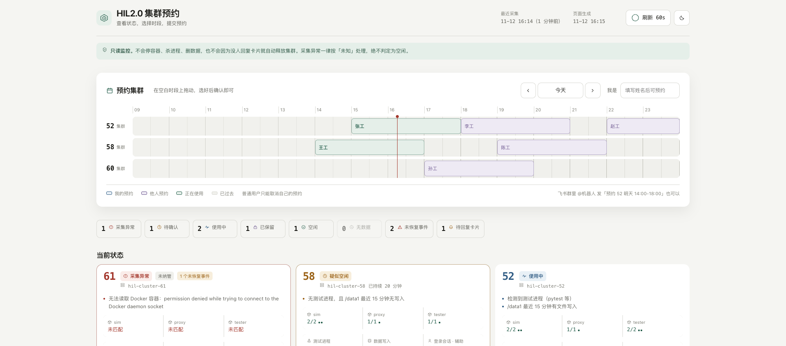

# HIL2.0 GPU クラスタ引き継ぎ

**言語:** [简体中文](README.md) · [English](README.en.md) · 日本語

共有 GPU テストクラスタ向けの読み取り専用監視、予約、人による確認を伴う引き継ぎツールです。Docker、プロセス、最近の書き込み、GPU、ログインセッションを収集します。コンテナ停止、プロセス終了、データ削除、自動解放は行いません。収集に失敗した場合は `IDLE` ではなく `UNKNOWN` と判定します。

## デモの起動

Python 3.11 以上と [uv](https://docs.astral.sh/uv/) が必要です。`uv sync --extra dev`、`uv run python scripts/seed_demo.py` を実行します。`FEISHU_EVENT_MODE=off uv run python -m hil2` で起動し、`http://127.0.0.1:8848` を開いてください。デモのクラスタとユーザーは架空です。Feishu の認証情報は不要です。テストは `uv run pytest -q` と `bash tests/test_install_script.sh` で実行できます。

## 実環境への導入

`.env.example` を `.env` にコピーして必要な設定を入力します。[導入手順](docs/DEPLOYMENT.md)と[運用手順](docs/OPERATIONS.md)を参照してください。クラスタごとにエージェントのプッシュ方式または SSH プル方式を選べます。実機で収集する前に、コンテナ判定ルールと読み取り専用 SSH アカウントを確認してください。Feishu カードは利用者に確認を求め、時間切れでは通知と管理者へのエスカレーションのみ行います。実際の Feishu・クラスタ連携はデモの検証範囲外です。

MIT License。認証情報や実ユーザーデータは含みません。

## 言語

画面右下の選択メニューで中国語・英語・日本語のナビゲーション、フィルター、主な状態表示を切り替えられます。外部のタイトル、原文、診断の詳細は元の言語のまま表示します。
