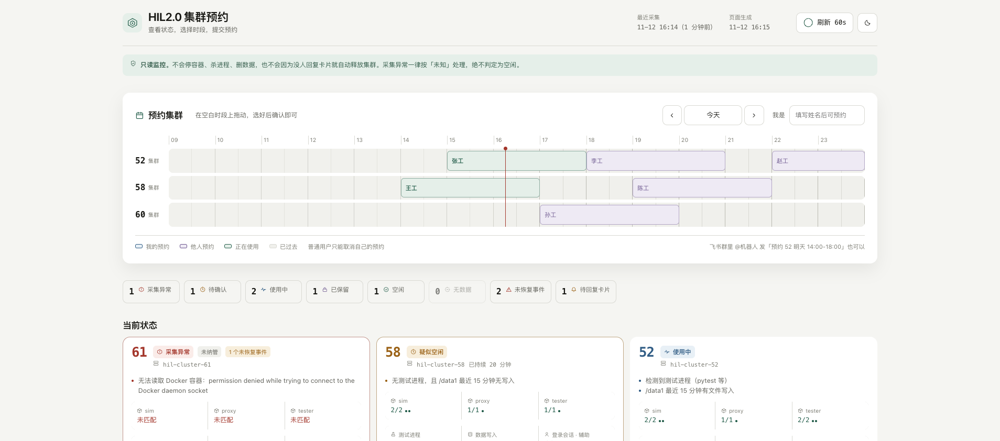
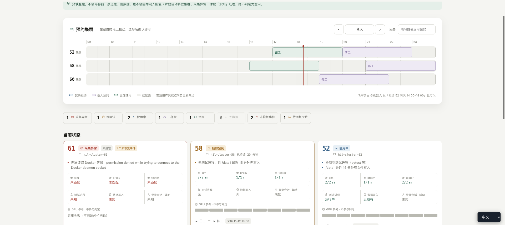
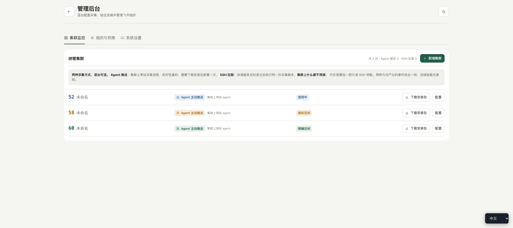

**语言 / Language / 言語:** [简体中文](README.md) · [English](README.en.md) · [日本語](README.ja.md)

# HIL2.0 集群闲忙监控与飞书人工交接

**共享 GPU 集群最难回答的不是“GPU 是否忙”，而是“这台机器现在能不能交给下一位”。** 进程停了可能还在保留环境；GPU 高也不等于有人在用。HIL2 把机器事实、时段预约和占用人确认放在同一条交接链上，让管理员有依据地协调资源。

需要安装协助、私有化部署，或按你的业务流程定制，可通过 [buildwithneo.cn](https://buildwithneo.cn) 联系。

| 场景 | 使用者实际得到什么 |
|---|---|
| 多人共用测试机、靠群聊问“谁在用” | 一个能看到采集事实、占用与预约的页面 |
| 容器还开着但测试进程与近期写入都没有 | “疑似空闲”卡片，请当前占用人确认；不会擅自交给别人 |
| 采集失败或权限不足 | 明确标为 `UNKNOWN` 并通知管理员，不把错误当空闲 |
| 下一位要安排时间 | 半小时粒度预约、到期提醒与人工交接记录 |

### 看它如何工作（全部为模拟集群数据）

**1. 一眼看到每台集群为什么忙、为什么空闲，采集失败也可见。**



**2. 把“我要什么时候用”放到同一张预约时间板。**



**3. 管理员可逐台选 Agent 推送或 SSH 拉取，并调整采集规则。**



联调期的集群**监控 + 预约**闭环。自动采集机器事实，但**不擅自推断用户意图**：找到「环境还开着、GPU 还高，但实际上已经没人用」的集群，通过飞书卡片让当前占用人确认，再把资源交给下一位。同时提供半小时粒度的时段预约，网页和飞书群里都能约。

## 三条安全边界

整套系统围绕三条边界设计，任何改动都不得突破：

1. **只读监控** — 不停容器、不杀进程、不删数据、不重启机器。
2. **采集异常绝不判空闲** — 关键采集失败一律 `UNKNOWN`，只告警管理员。
3. **绝不自动释放** — 无论多久没人回复卡片，集群都不会被自动释放；超时只提醒和升级。

这三条在 `tests/test_acceptance.py::TestSafetyBoundaries` 里有专门的兜底测试。

## 架构

```
┌─ 管理后台 /admin ───────────────────────────────────────────┐
│  集群增删改 · 采集方式切换 · 阈值与容器规则                     │
│  下载每台专属 agent 安装包 · 飞书组织同步 · 管理员指派           │
└───────────┬─────────────────────────────────────────────────┘
            │ 集群注册表（改完立即生效，不用重启）
            ▼
┌─ 采集：两种方式，逐台可选，产出完全相同的事件 ─────────────────┐
│                                                             │
│  ① Agent 推送   集群上常驻 hil_agent.py，到点自己采集上报        │
│                 实时性最好，需要部署一次（后台下载安装包）        │
│                                                             │
│  ② SSH 拉取     协调服务定时 ssh 过去，把同一份采集脚本喂给       │
│                 远端 python 执行。**集群上什么都不用装**         │
│                                                             │
│  两种方式都只读：docker ps · pgrep pytest · find -mmin · who  │
│  GPU 与登录会话仅作参考展示，从不单独参与闲忙判定                 │
└───────────┬─────────────────────────────────────────────────┘
            │  同一份 hil.monitor.v1 JSON
            │  ① Feishu Webhook → 独立监控群       （隔离网络主通道）
            │     内网协调服务经开放 API 轮询群消息并消费 EVENT_JSON
            │  ② HTTP POST → /api/ingest          （可达时的备用直连）
            ▼
┌─ 协调服务 hil2 ─────────────────────────────────────────────┐
│  event_id 幂等去重 → flow_engine.decide() → 动作             │
│  预约数据源（file / http 可插拔）                              │
│  飞书入站：Channel SDK 长连接（默认）/ HTTP 回调（可选）   │
│  卡片下发 + card.action.trigger（四道校验）                    │
│  10 分钟提醒 / 20 分钟升级管理员（永不释放）                     │
│  SQLite：事件 / 快照 / 卡片 / 预约 / 审计 / 未恢复事件           │
└───────────┬─────────────────────────────────────────────────┘
            ├──→ 业务大群：占用确认卡片 · 通知下一位
            ├──→ 监控群：管理员告警
            └──→ Web 大盘 /（飞书免登可选）
```

## 五态判定

判定优先级即代码里的分支顺序，不得调整：

| 顺序 | 状态 | 判定条件 | 对外动作 |
|---|---|---|---|
| 1 | `UNKNOWN` 采集异常 | Docker / pytest 检查 / `/data1` 任一关键采集失败，或核心容器规则匹配不上 | 只告警管理员，**绝不降级为空闲** |
| 2 | `IDLE` 明确空闲 | `sim / proxy / tester` 全部停止，且无有效保留 | 不打扰上一位，直接 `@下一位` |
| 2 | `RESERVED` 保留中 | 核心容器全停但保留声明仍有效 | 到期前不打扰 |
| 3 | `BUSY` 使用中 | 存在 pytest（或现场确认的其他测试进程），或 `/data1` 近 15 分钟有写入 | 平时只留监控群；仅在交接到期且下一位在等时发卡片 |
| 4 | `RESERVED` 保留中 | 无活动但有有效保留 | 到期前不重复催问 |
| 5 | `SUSPECTED_IDLE` 疑似空闲 | 容器仍在，连续 15 分钟无测试进程、无数据写入、无保留 | `@当前占用人`发确认卡片；**确认前不通知下一位** |

**GPU 从不参与判定。** GPU 高不能证明在用，GPU 低不能证明空闲；只在大盘上作为参考展示。

**登录会话也不单独参与判定。** Agent 用只读 `who` 采集会话数和用户名，帮助管理员
定位谁可能登录着。系统只有在测试进程或近期数据写入已经确认机器在用、同时又没有
有效预约时，才建立「未预约使用」事件并首次告警管理员；后续采样不重复刷屏。

## 管理后台

浏览器打开 `/admin`：

- **集群监控** — 增删集群、切换采集方式、改阈值和容器识别规则；
  SSH 模式可一键「测试连接」和「立即采集」，Agent 模式可下载专属安装包
- **组织与权限** — 同步飞书通讯录，指派管理员；普通用户只能取消自己的预约，
  管理员可以取消任意预约
- **系统设置** — 群 ID、机器人 open_id、各类阈值，改完立即生效

涉及安全的项（应用密钥、上报密钥、JWT 密钥）只能改 `.env` 并重启，
网页上不提供也不回显。所有后台操作都记审计。

未开 SSO 时后台**只允许本机访问**，避免内网任何人都能改配置。

## 采集的两种方式

| | Agent 推送 | SSH 拉取 |
|---|---|---|
| 集群上要装东西 | 要（后台下载安装包，一条命令） | **不要** |
| 实时性 | 好，事件产生即上报 | 取决于拉取间隔 |
| 需要的权限 | 集群本地读 docker | 一把只读 SSH 钥匙 |
| 网络方向 | 集群 → 飞书 Webhook；内网系统 → 飞书开放 API | 协调服务 → 集群（入站） |
| 适用 | **GPU 网与内网隔离的环境** | 有免密自动化堡垒机时使用 |

两种方式跑的是**同一份采集脚本**——SSH 模式把 `hil_agent.py` 喂给远端
python 执行，因此五态判定逻辑不可能走偏，不存在两套实现慢慢漂移的问题。

SSH 拉取时远端强制 `HIL_DRY_RUN=1` 且不下发任何 webhook 地址，
脚本无从对外发消息；连不上、超时、脚本报错一律产出 `UNKNOWN`，绝不当成空闲。

## 预约

半小时粒度时段预约，一台集群同一时间只由一人独占。两个入口，同一套数据：

**网页**：大盘下方的预约看板，每天开放 09:00–24:00，在空白格上拖选即可下单。
普通用户只能取消自己的预约；后台设置的管理员可以取消任意人的预约。
开了 SSO 后用飞书账号登录，预约自动归到本人名下——在飞书里打开是免登的，
浏览器里点一次「飞书登录」即可。

**大盘本身始终免登可看**：它要挂在墙上给所有人扫一眼，
登录只用于「预约」和「进后台」。确需连看都管起来时把 `REQUIRE_LOGIN_TO_VIEW` 打开。

**飞书群**：@机器人 发指令

```
预约 52 明天 14:00-18:00      我的预约        查看 52
预约 58 下午2点到6点           取消 a1b2c3d4   帮助
```

预约与监控的接缝只有一处：`bookings` 派生出 `Reservation(current / next / handoff_at)`
喂给判定引擎。**换成正式预约 API 时，只要能产出同样的结构，引擎一行都不用改。**

续期不会挤占下一位：点「继续使用 60 分钟」时若下一位已约了紧邻时段，
只延长到对方开始为止，并在卡片上如实说明被谁挡住。

## 快速开始（Mac 或服务器）

```bash
cd hil2
make dev          # 建虚拟环境并装依赖（需要 uv；没有就 python3.11 -m venv .venv）
make test         # 跑全部测试
make demo         # 播种演示数据
make run          # 启动，浏览器打开 http://127.0.0.1:8848
```

不装 `uv` 的话：

```bash
python3.11 -m venv .venv && .venv/bin/pip install -e ".[dev]"
```

不配飞书也能跑：所有卡片会降级成本地审计记录，大盘照常工作。这正是灰度阶段的用法。

## 目录

| 路径 | 作用 |
|---|---|
| `hil2/registry.py` | 集群注册表：配置模型与校验 |
| `hil2/collector_ssh.py` | **SSH 拉取采集**：集群上零安装 |
| `hil2/puller.py` | 拉取调度：按各自间隔到点、连击计数 |
| `hil2/orgsync.py` | 飞书通讯录同步 |
| `hil2/packaging.py` | 生成每台集群专属的 agent 安装包 |
| `hil2/admin.py` | 管理后台接口 |
| `scripts/install_agent.sh` | **一键安装** agent（幂等、默认灰度、装完自检） |
| `scripts/deploy_agents.sh` | **批量部署**到多台集群（SSH 推送） |
| `hil2/booking.py` | 时段预约模型：半小时对齐、冲突检测、中文时间解析 |
| `hil2/booking_service.py` | 预约服务：飞书指令闭环 + 到点提醒 |
| `agent/hil_agent.py` | 集群侧只读采集（零依赖，直接拷到集群上跑） |
| `agent/probe_site.py` | P0 现场只读探测，输出建议配置 |
| `hil2/flow_engine.py` | 决策引擎，与飞书 SDK 完全解耦 |
| `hil2/coordinator.py` | 把决策变成真实动作，负责 fail-closed |
| `hil2/store.py` | SQLite：幂等去重、卡片状态、预约、审计 |
| `hil2/feishu/` | 客户端 / 卡片 / 回调解密验签 / 免登 SSO |
| `hil2/web/` | 大盘前端（零构建，原生 JS + CSS） |
| `deploy/` | systemd · launchd · Docker · 最小 sudo 规则 |
| `docs/` | 部署、运维、验收文档 |

## 文档

- [部署指南](docs/DEPLOYMENT.md)
- [运维手册](docs/OPERATIONS.md)
- [验收清单](docs/ACCEPTANCE.md)

## 测试

```bash
make cov
```

原项目记录有 623 个用例；发布副本以本仓库 CI 的结果为准；其中决策引擎 `flow_engine.py` 有独立分支测试。
`make test` 同时会跑安装脚本的沙箱测试（`tests/test_install_script.sh`）。
`tests/test_acceptance.py` 的类名与交接文件第 11 节的 12 项验收标准一一对应，便于逐条勾选。

## 语言

网页右下角可切换中文、English、日本語；主导航、筛选和常用状态会随之切换。来自外部系统的标题、原文和诊断详情保留来源语言。
